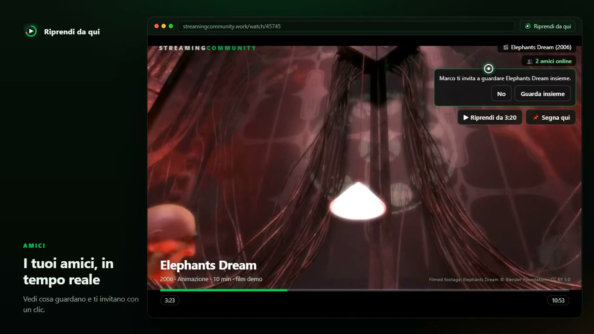

# Riprendi da qui

**Il tuo film, sempre da dove l'hai lasciato.**

Estensione Chrome per [StreamingCommunity](https://streamingcommunity.work): salva il punto esatto in cui sei arrivato, tiene una libreria in stile Letterboxd e ti fa guardare insieme ai tuoi amici, in tempo reale.

▶ **[Guarda il trailer (47s)](https://voe.sx/s65xvmuucdcp
)** · **[Scarica l'ultima versione](../../releases/latest)**

---

## Cosa fa

### Non perdi più il punto
- **Salvataggio automatico** mentre guardi, in pausa e alla chiusura della scheda. Se il player riparte da zero o torni indietro con la barra, il nuovo punto sostituisce il vecchio: niente più "film sbagliato".
- Pulsante **📌 Segna qui** e scorciatoie `Alt+S` (segna) / `Alt+R` (riprendi).
- **Riprendi da 1:12:30** con un clic dal player, dal popup o dalla dashboard.
- **Più film insieme**: puoi tenere aperte più schede o più film, ogni punto resta al suo posto (scritture serializzate, nessuna sovrascrittura).

### Libreria in stile Letterboxd
- Watchlist, film visti, voti a mezza stella, cuori, recensioni personali.
- Consigli, ricerca e schede film/serie alimentati da **TMDB** (copertine, cast, durata, dove si guarda in Italia).
- "Continua a guardare" con la barra di avanzamento di ogni titolo, film e serie TV.

### Sincronizzazione automatica con Letterboxd
- **Importa** il tuo profilo: watchlist, visti, voti e cuori.
- **Sync in tempo reale**: ogni modifica (voto, cuore, visto, watchlist) viene inviata a Letterboxd pochi secondi dopo, e ogni 2 minuti l'alarm riallinea tutto.
- Sicura: i titoli importati non vengono riscritti, un cuore o un voto non vengono **mai** tolti se non li hai tolti tu, le serie TV vengono ignorate (Letterboxd non le ha).
- Stato leggibile in Impostazioni: utente collegato, coda, ultimo invio, errori.
- Se non usi Letterboxd, non serve: l'estensione funziona da sola.

### Amici, in tempo reale
- **Profilo e cerchia**: crea un codice (es. `LUNA42`) e chi lo inserisce entra nella tua cerchia. Nessun account, nessun server.
- Vedi **chi è online e cosa sta guardando** (titolo, episodio, minuto, pausa), con badge discreto sul player.
- **Guarda insieme**: invita un amico, accetta dall'invito (anche dal player) e la visione resta allineata — play, pausa e spostamenti si propagano subito, con compensazione della latenza e correzione della deriva ogni ~2,5 s.
- Tecnologia: **[trystero](https://github.com/dmotz/trystero)** (WebRTC peer-to-peer, incluso in `vendor/`). La stanza vive in un documento offscreen, così non muore quando Chrome sospende il service worker.

### I tuoi dati restano tuoi
- Tutto in `chrome.storage.local`; nessun backend dell'estensione.
- **Backup** e **sync su file** locale (File System Access API): un JSON che puoi mettere su Drive/Dropbox.
- Gli amici si parlano in P2P cifrato da WebRTC; nessun dato passa da un server nostro.
- TMDB viene chiamato solo per i metadati; Letterboxd solo se attivi la sync.

---

## Installazione

1. Scarica lo zip dall'[ultima release](../../releases/latest) e scompattalo (oppure clona il repo).
2. Apri `chrome://extensions`, attiva **Modalità sviluppatore**.
3. **Carica estensione non pacchettizzata** → seleziona la cartella `riprendi-da-qui-v6` (quella con `manifest.json`).
4. Apri StreamingCommunity: il badge dell'estensione appare sul player.

### Prima configurazione (consigliata)
- **Chiave TMDB** → Impostazioni: serve per titoli, copertine e consigli. La trovi gratis su [themoviedb.org](https://www.themoviedb.org/settings/api).
- **Cerchia** → vista *Amici*: crea un codice o entra in uno esistente.
- **Letterboxd** → Impostazioni: collega il profilo e attiva la sync automatica.

Dopo ogni aggiornamento dei file, ricarica l'estensione da `chrome://extensions` e ricarica le schede di StreamingCommunity.

---

## Struttura

| File | Cosa fa |
| --- | --- |
| `manifest.json` | Manifest V3, permessi, icona, pagina offscreen |
| `background.js` | Service worker: progressi (unico scrittore, coda seriale), contesto film, Letterboxd, presenza e party |
| `content.js` | Overlay sul player: HUD, ripresa, salvataggio, inviti e sync della visione insieme |
| `social.js` / `social.html` | Stanza trystero nel documento offscreen: presenza, inviti, eventi del player |
| `dashboard.js` / `dashboard.html` / `dashboard.css` | Libreria, continua a guardare, consigli, amici, impostazioni |
| `progress.js` | Chiavi canoniche, merge e "vita" delle voci di avanzamento |
| `letterboxd.js` / `letterboxdsync.js` | Import da esportazione Letterboxd e push automatico |
| `tmdb.js`, `titleparse.js`, `sync.js`, `backup.js`, `filelink.js` | Metadati, parsing dei titoli, sync/backup su file |
| `vendor/trystero.js` | Trystero (MIT) |

---

## Crediti

- Filmed footage del trailer: **Elephants Dream** © Blender Foundation, licenza [CC BY 3.0](https://creativecommons.org/licenses/by/3.0/) — usato come film demo.
- Questo prodotto usa le API di TMDB ma non è approvato né certificato da TMDB.
- [trystero](https://github.com/dmotz/trystero) di Dan Motzenbecker, MIT.
- Letterboxd è un marchio dei rispettivi proprietari; l'estensione non è affiliata.

L'estensione non ospita né distribuisce contenuti: salva solo la posizione di visione e i tuoi dati personali.
